<p align="center">
  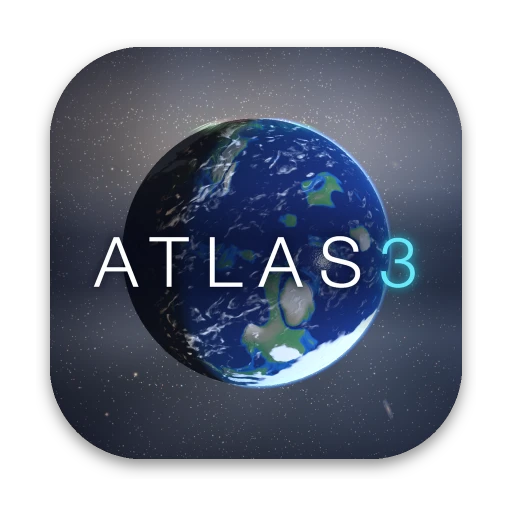
</p>

<h1 align="center">The Atlas</h1>

<p align="center"><b>A procedural universe you can fly through, in real time.</b><br>
Sextillions of galaxies, every star a real system, every planet rendered from its own data. No database, no stored content: one seed, and the mathematics does the rest.</p>

<p align="center">
  <a href="https://the-atlas.koyeb.app/">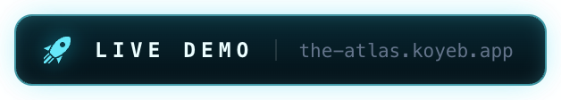</a>
  <a href="https://hub.docker.com/r/bansheetech/atlas">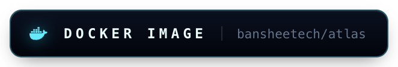</a>
</p>

<p align="center">
  
  
</p>

<p align="center">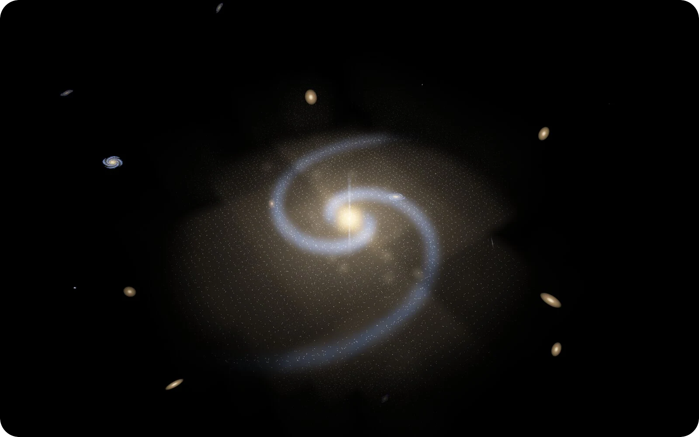</p>

---

## Contents

- [What is The Atlas](#what-is-the-atlas)
- [Exploring](#exploring)
  - [Galaxies](#galaxies)
  - [Star systems](#star-systems)
  - [Planets](#planets)
  - [Life and phenomena](#life-and-phenomena)
  - [Hyperjumps and the multiverse](#hyperjumps-and-the-multiverse)
  - [On mobile](#on-mobile)
- [How big is The Atlas](#how-big-is-the-atlas)
- [Controls](#controls)
- [Running The Atlas](#running-the-atlas)
- [Configuration](#configuration)
- [Architecture](#architecture)
- [Detail examples](#detail-examples)
- [Security, license and changelog](#security-vulnerabilities)

---

## What is The Atlas

<p align="center">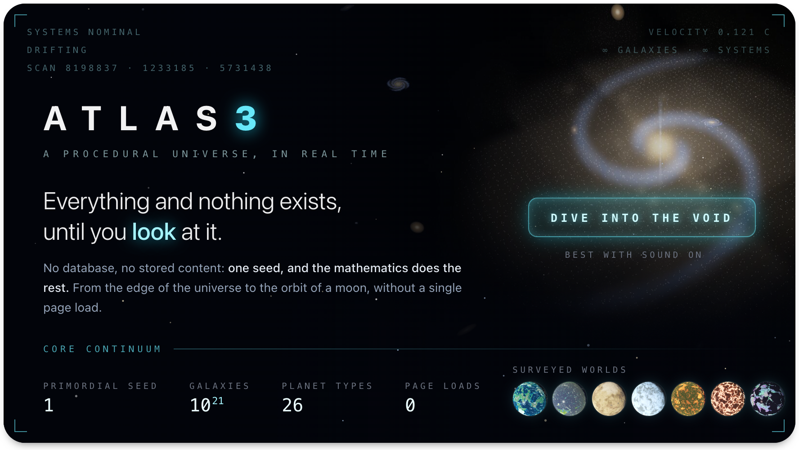</p>

_The Atlas_ is a procedural generation engine for whole universes, and **ATLAS3** is the way to travel them: a single, continuous 3D space built with Three.js, where you go from the edge of the universe to the orbit of a moon without a single page load.

- **Nothing is stored.** Galaxies, stars, planets, moons, their orbits and their surfaces are generated on demand from a primordial seed. Everything and nothing exists until you look at it, and it is always the same when you come back.
- **Every point of light is real.** Each star in a galaxy is an actual system you can fly to, with its planets moving on real orbits in real time.
- **Planets are drawn from their data.** Type, temperature, atmosphere, life and composition shape what you see, from continents and clouds to crystal fields and magma oceans.
- **Shared universe.** The default universe, the _Core Continuum_, is the same for everyone: any place can be shared with a Stargate link, and other people's universes can be visited through the peer-to-peer multiverse.

<p align="center">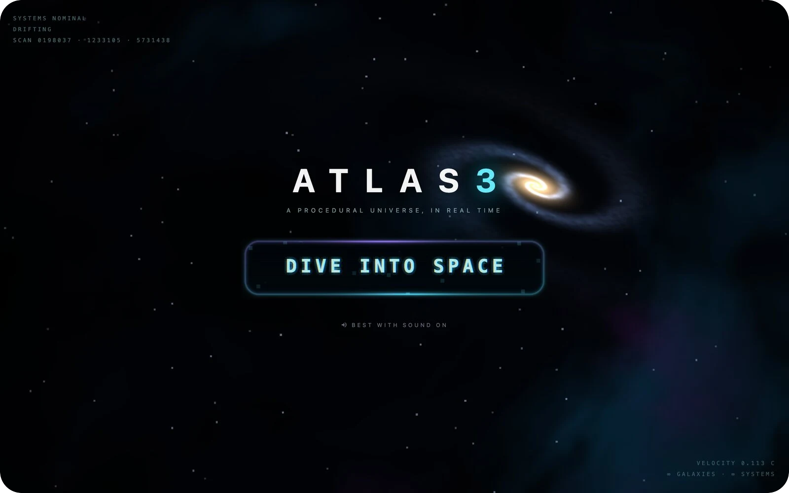</p>

---

## Exploring

### Galaxies

Spiral, elliptical and dwarf galaxies, with bulges, bars, arms, globular and open clusters, black holes, pulsars and quasars. They are drawn with a level-of-detail system that streams billions of systems into view: from afar a galaxy is a glow, and as you fly in it resolves into individual stars, each one a destination. Your neighbouring galaxies hang in the sky around you.

<p align="center">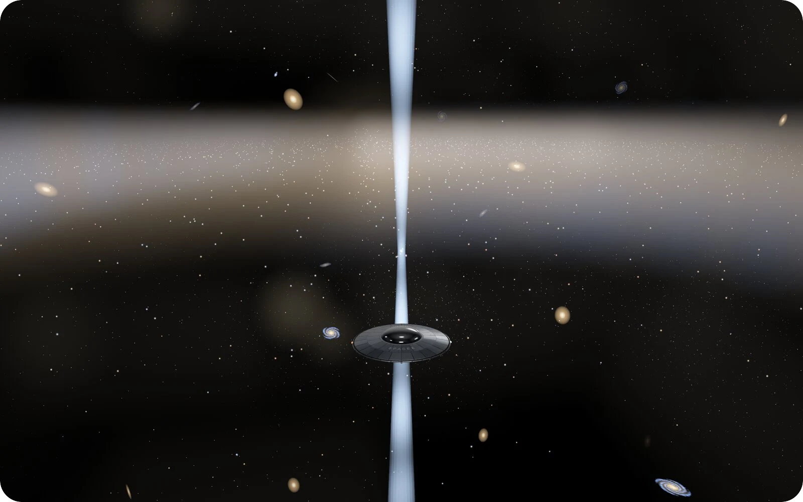</p>

### Star systems

Single and multiple stars, with planets on orbits computed from their real periods. Time runs in real time by default; speed it up to a year per second to watch whole orbits go by, and return to the present with one click.

<p align="center">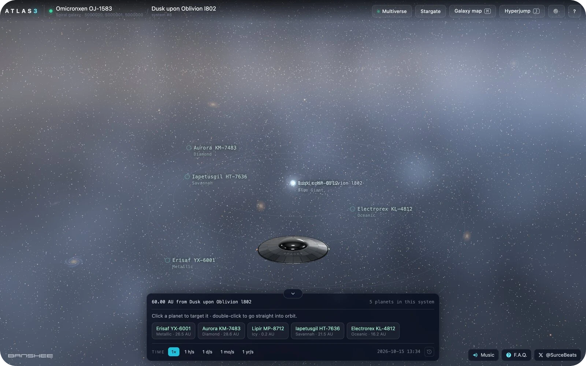</p>

### Planets

Every one of the 31 planet types has its own physically based renderer, and every planet draws its own structure from its seed, so no two planets of a type share a shape:

- **Earth-like worlds** (Oceanic, Forest, Super Earth, Sub Earth, Savannah, Swamp, Tundra, Aquifer): continents, mountain belts, climate, vegetation, polar caps, clouds that cast shadows, city lights on the night side.
- **Gas and ice giants** (Gas Giant, Frozen Gas Giant, Nebulous): bands that shear at their own speed, storms, polar hexagons, rings that cast and catch shadows.
- **Molten worlds** (Lava, Magma, Molten Core): a crust cracked over glowing rock, a magma ocean with drifting rafts, or a mantle torn open to white-hot chasms.
- **Minerals** (Diamond, Crystalline, Metallic): diamond with real refraction, dispersion and fire; crystal fields that flash in the starlight; bare metal with oxide crusts.
- **And the rest**: deserts with dunes and rifts, cratered and icy moons, radioactive worlds with luminous sludge, toxic veiled worlds, exotic matter and anomalies.

Atmospheres are rendered with single scattering, so limbs glow and sunsets redden at the terminator. Moons orbit their planets, pass through its shadow in eclipse, and can be visited too.

<p align="center">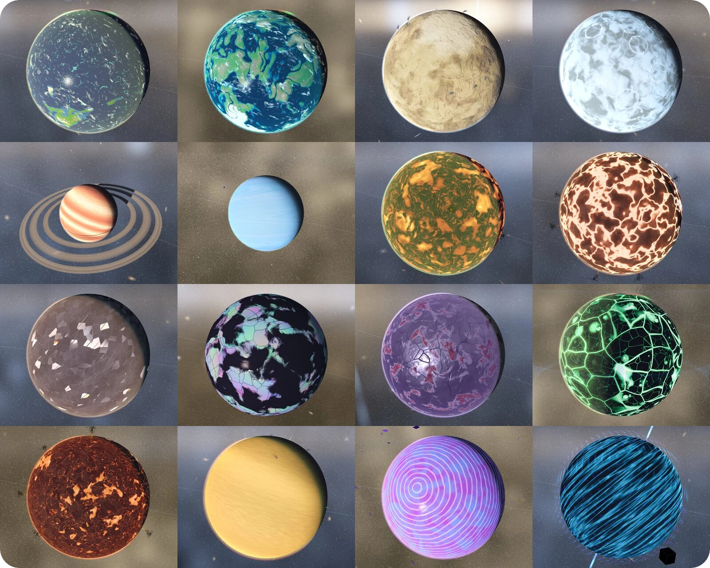</p>
<p align="center">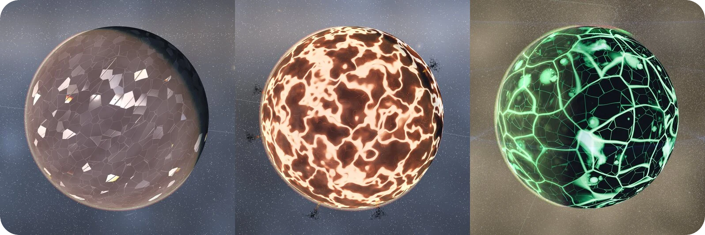</p>

### Life and phenomena

Life and what happens on a planet show from orbit:

| Life or phenomenon         | What you see                                                         |
| -------------------------- | -------------------------------------------------------------------- |
| **Intelligent Life**       | Satellite constellations, an orbital station, city lights at night  |
| **Robotic Entities**       | Hundreds of machines in orbit around an orbital ring                 |
| **Silicon-Based Life**     | Networks of glowing veins across the ground                          |
| **Conscious Gas**          | Luminous clouds that drift and pulse on their own                    |
| **Non-Physical Entity**    | An ethereal halo crossed by slow ripples                             |
| **Bacteria, plants, animals** | Plankton blooms swirling in the oceans                            |
| **Volcanism, storms**      | Eruption plumes, smoke, toxic seeps, blowing snow and dust           |
| **Radiation, anomalies**   | Radiation belts and auroras, polar jets, phase ripples, a monolith  |
| **Have I just found God?** | Ultra-rare. See for yourself.                                        |

<p align="center">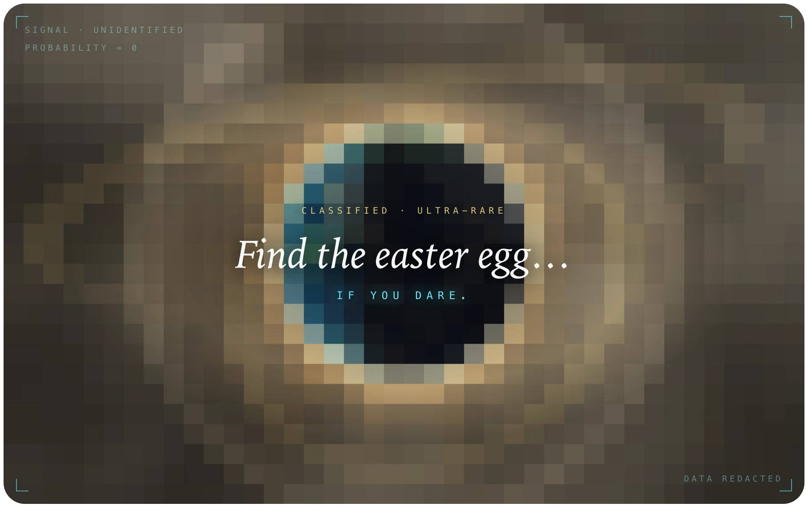</p>

### Hyperjumps and the multiverse

Jump to any galaxy by its coordinates, to a neighbour you can see in the sky, or somewhere random. The drive charges, a wormhole opens and bends everything on screen around its mouth, and you ride hyperspace until the new galaxy opens up in front of you.

- **Stargates**: share a link to the galaxy, system or planet where your ship is, or keep it in your saved places and travel back to it at any time.
- **The multiverse**: universes discovered through the peer-to-peer network can be visited from the explorer.
- **Sound**: a soundtrack and quiet, synthesised ship sounds for flights, jumps and selections.

<p align="center">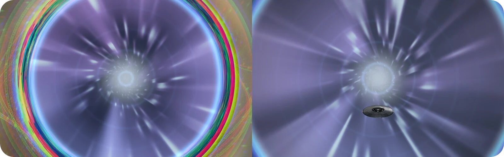</p>

### On mobile

The whole explorer works on phones and tablets, with touch controls, a collapsible console and graphics quality presets.

<p align="center">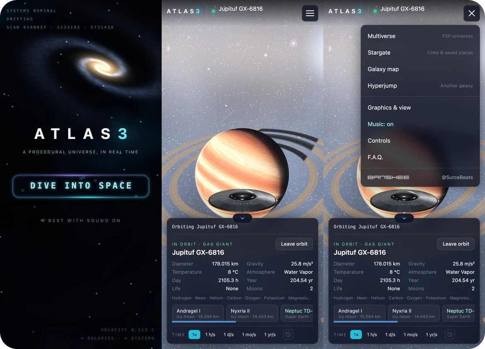</p>

---

## How big is The Atlas

<p align="center">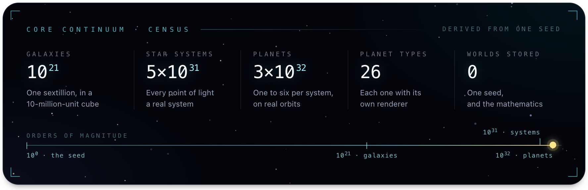</p>

- **Galaxies**: up to **1 sextillion** (10²¹), placed in a 10-million-unit coordinate system.
- **Galaxy types**: dwarf galaxies (100,000 to 10 million systems), spiral galaxies (1 to 50 billion systems) and elliptical galaxies (10 to 100 billion systems).
- **Star systems**: about **50 nonillion** (5 × 10³¹).
- **Planets**: 1 to 6 per system, about **300 nonillion** (3 × 10³²) in all.

---

## Controls

| Input                    | Action                               |
| ------------------------ | ------------------------------------ |
| Drag                     | Look around                          |
| Scroll / pinch           | Zoom across scales                   |
| Right drag / Shift       | Pan                                  |
| W S · ↑ ↓                | Thrust forward / back                |
| A D · ← →                | Turn                                 |
| Q E · R F                | Slide sideways · up / down           |
| Click                    | Target a star, planet or moon        |
| Double-click · Enter     | Engage: travel, or go into orbit     |
| Esc                      | Back out one level                   |
| M                        | Galaxy map                           |
| H                        | Return to your ship                  |
| J                        | Hyperjump to another galaxy          |
| P                        | Take a photo, with a QR code to the place |
| ?                        | Controls                             |

---

## Running The Atlas

### Docker

```yaml
services:
  the-atlas:
    image: bansheetech/atlas:latest
    container_name: the-atlas
    ports:
      - "42424:42424"
    environment:
      - EXTERNAL_P2P_OPEN_PORT=42424
      - ENABLE_P2P=true
    volumes:
      - ./atlas_docker_volume:/app
    restart: always
```

Then open `http://localhost:42424`. The image is also available directly as **`bansheetech/atlas:latest`**.

### From source

```bash
pip install -r requirements.txt
python3 __main__.py
```

The built frontend ships in `atlas-ui/react/dist`. To work on the frontend, install the Node dependencies (`npm install`) and run the Vite dev server (`npm run dev`) next to the Python server; `npm run build` produces the bundle and `npm test` runs the explorer's tests.

### HomeDock OS

Download [HomeDock OS](https://github.com/BansheeTech/HomeDockOS) and install The Atlas from its App Store.

<p>
  <a href="https://github.com/BansheeTech/HomeDockOS"></a>
</p>

---

## Configuration

On first start, the _Atlas Initialization Protocol_ asks which universe to open:

- **Core Continuum**: the default universe, shared by everyone. Stargate links work between any two Atlas instances.
- **Design the Multiverse**: your own universe from a seed of your choice. For Stargate links to work between instances, both must share the same seed and `cosmic_origin_time` in `atlas.ini`, or your server must be reachable from the internet.

Physical constants and generation parameters can be tuned in `pymodules/__universe_constants.py`.

---

## Architecture

```
Frontend: React + Three.js (atlas-ui/react/static/js)
├── Explore/engine     One renderer for the whole universe: floating origin,
│                      HDR deep sky, tonemapping, wormhole pass, ship view
├── Explore/galaxy     Galaxy model, level of detail in a Web Worker, neighbours
├── Explore/system     Stars and planets on real orbits
├── Explore/planet     Realistic planets (GLSL surfaces, clouds, atmospheric
│                      scattering, rings, effects) and moons
├── Explore/audio      Soundtrack and synthesised WebAudio effects
└── Explore/ui         Cockpit: console, panels, Stargates, F.A.Q., front door

Backend: Python + Flask, served by Hypercorn (pymodules)
├── Procedural generation of universes, galaxies, systems, planets and moons
├── REST API consumed by the explorer
├── Orbital mechanics and cosmic time
├── Cache
└── Peer-to-peer multiverse
```

The frontend is bridged into Flask templates with [vite-fusion](https://pypi.org/project/vite-fusion/).

---

## Detail examples

Photos taken in the explorer (press P): each one stamped with where it was taken, and a QR code to fly there.

<p align="center">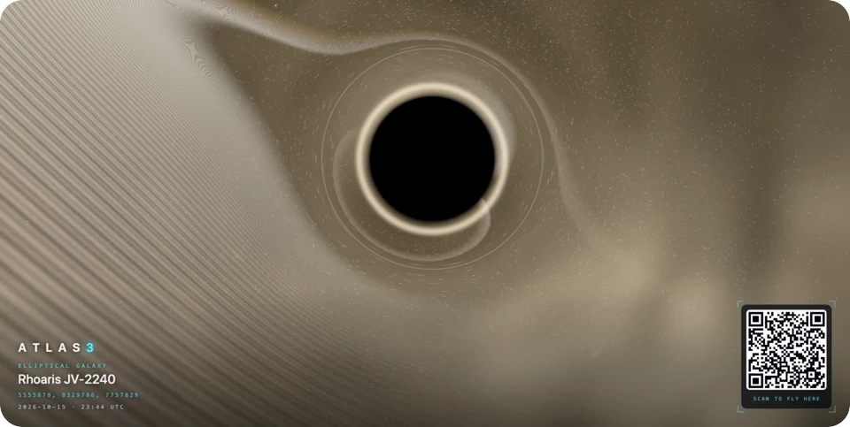<br><sub>The black hole at the heart of the elliptical galaxy Rhoaris JV-2240, bending the light around it</sub></p>

<p align="center">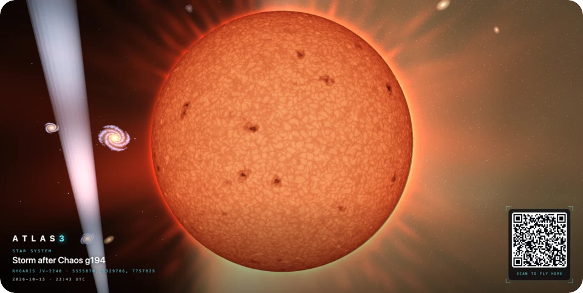<br><sub>The star of Storm after Chaos g194, with its sunspots and corona, and a quasar's jet behind it</sub></p>

<p align="center">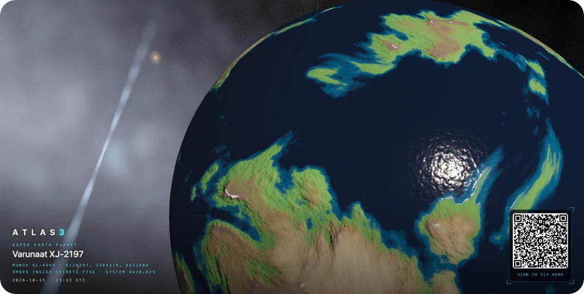<br><sub>Varunaat XJ-2197, a super Earth: continents, shallow seas and the glint of its star on the ocean</sub></p>

<p align="center">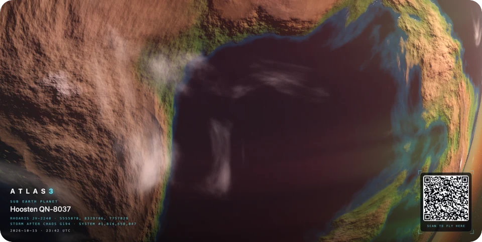<br><sub>Hoosten QN-8037, a sub Earth, from low orbit: mountains, a dark sea and drifting clouds</sub></p>

<p align="center">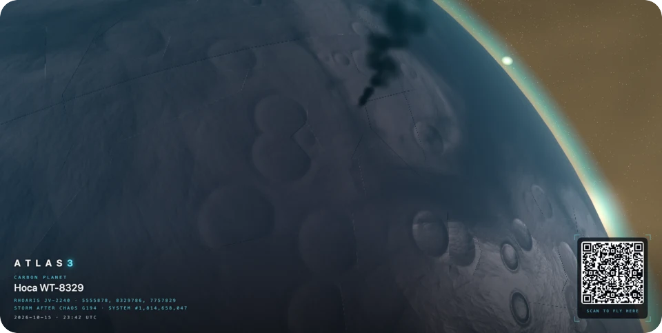<br><sub>Hoca WT-8329, a carbon planet, cratered, with smoke rising from its surface</sub></p>

<p align="center">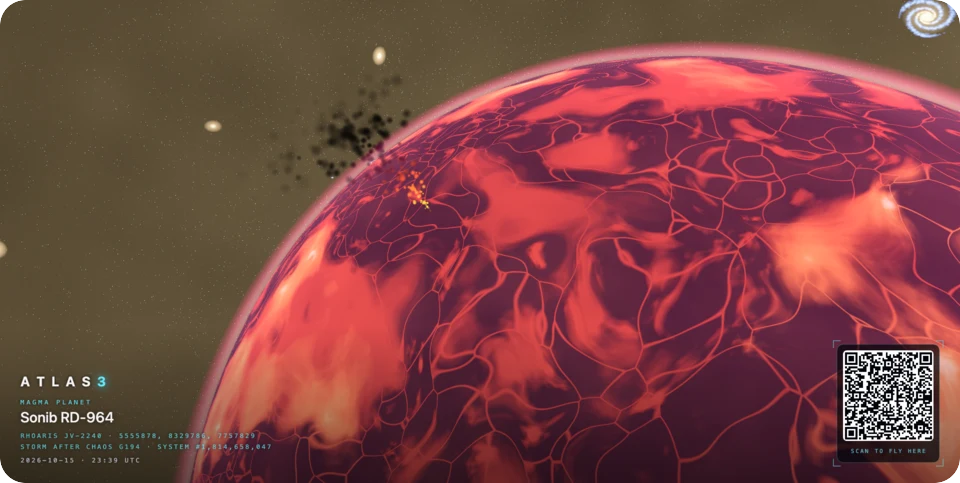<br><sub>Sonib RD-964, a magma planet: a molten ocean under drifting rafts of crust</sub></p>

<p align="center">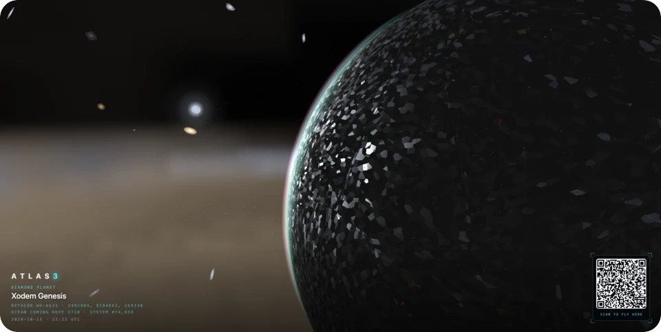<br><sub>Xodem Genesis, a diamond planet, its facets catching the light</sub></p>

<p align="center">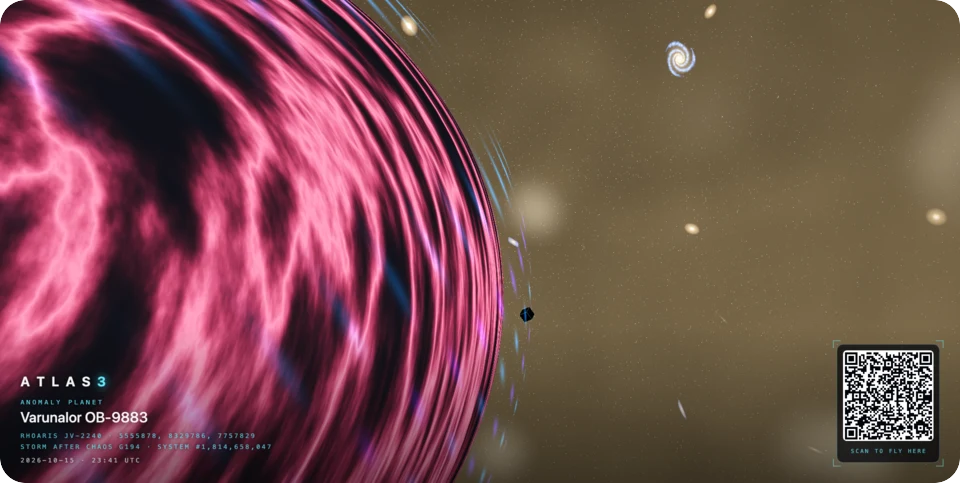<br><sub>Varunalor OB-9883, an anomaly planet</sub></p>

<p align="center">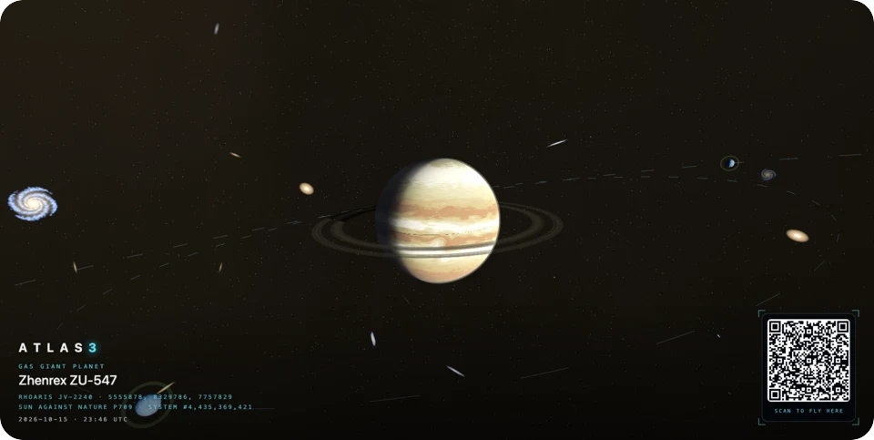<br><sub>Zhenrex ZU-547, a ringed gas giant, and the orbits of its system</sub></p>

---

## Security vulnerabilities

If you discover a security vulnerability, please contact us at [hello@banshee.pro](mailto:hello@banshee.pro). We take security seriously and will address any issue as soon as possible.

## License

Created by [Claudio González](https://github.com/SurceBeats) at [Banshee](https://www.banshee.pro/).
_The Atlas_ is licensed under the [PolyForm Noncommercial License 1.0.0](LICENSE.md), which prohibits all commercial use, including but not limited to:

- creating, selling or distributing NFTs;
- using the software for cryptocurrency-related activities;
- selling artwork or services generated by the software for commercial gain.

## Changelog

See the [Changelog](CHANGELOG.md) for every update, fix and improvement.

---

## How The Atlas was made

- **Atlas v1**, the original 2D universe drawn with Pillow, was written almost entirely by hand.
- **Atlas v2**, which brought Three.js to some of its sections, was partially assisted by ChatGPT in a few of them.
- **Atlas v3** was assisted by Anthropic's Claude Opus 5.5 for roughly 30% of the work. Given the complexity and the sheer density of data involved, developing it coherently would have been practically impossible for a single person, above all the redesign of the planets and their effects, and representing galaxies as one continuous cube instead of one asset per page.

## Disclaimer

Neither _The Atlas_ nor Banshee is affiliated with, endorsed by or sponsored by SpaceX, PLD Space, OpenAI (ChatGPT) or Anthropic. The names on the ships are a tribute only. All product names, logos and brands are the property of their respective owners and are used for identification purposes only.
